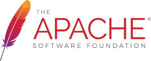

 &nbsp;&nbsp;&nbsp;&nbsp;&nbsp; 

I’m a "silver" software architect and developer writing open source software for fun.

I'm a contributor to several open-source projects like [Apache Camel](https://github.com/apache/camel), [Wildfly](https://www.wildfly.org), [Drools](https://www.drools.org) and others.

I was in charge of dozens of large and complex projects across European countries. My core business is the cloud native software design, development and implementation in Java, Jakarta EE, Quarkus or Spring Boot,
and their deployment on platforms like AWS, Openshift and GCP.

I'm also a devops practitioner with extensive experience in IaC (Infrastructure as Code) using AWS CLI, AWS CloudFormation, AWS CDK and Terraform.
I'm a miroservices evangelist, specialized on the back-end side of the applications but, a couple of years ago, given the unavoidable importance that the JavaScript libraries have taken, I started to spend time
working on the front-end side as well, using Node.jsand Angular, but also older stacks like jQuery.

I'm working on the behalf of my own company, Simplex Software, created in Paris in 2004. My clients are, in general, banks and other financial institutions.

I'm also a technical writer, author of several books, including best sellers in France. [See all my books](/books/)

My full CV is available [as a PDF](/assets/files/resume-nicolas.pdf) and on [LinkedIn](https://www.linkedin.com/in/duminilnicolas/).
