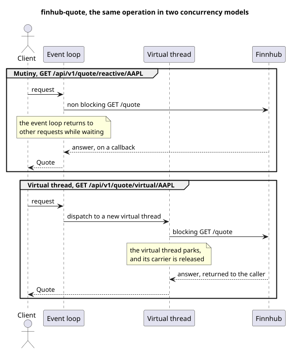
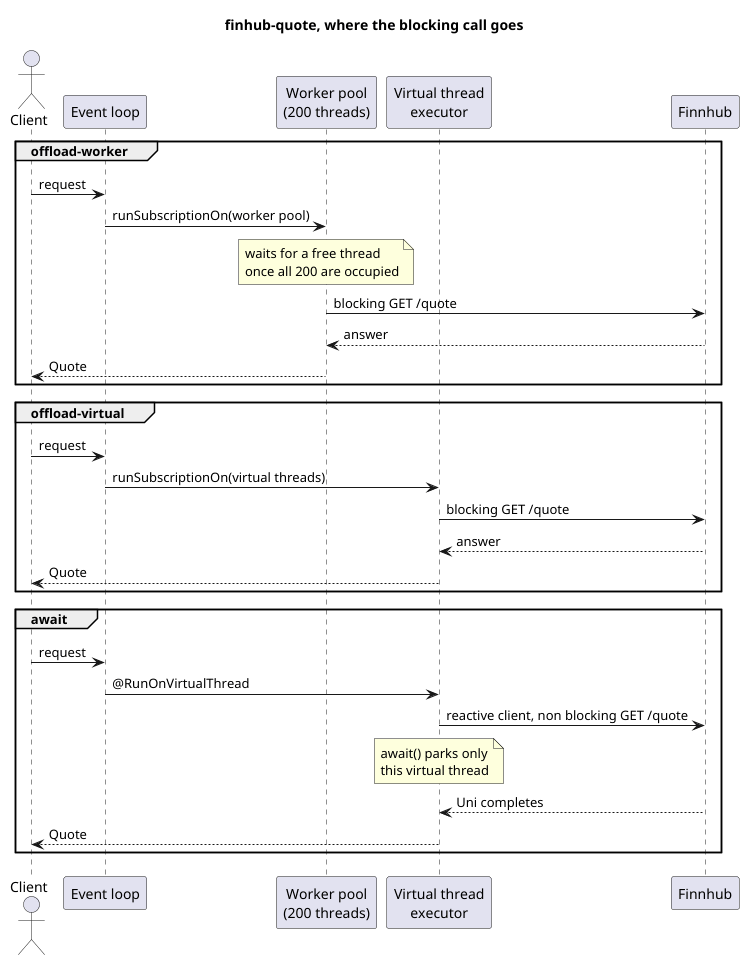

## Abstract

This article compares the reactive style, as provided by Mutiny, with virtual threads, on one on demand HTTP operation. It explains how the two relate, shows the sequence diagram and code of each example, and analyzes the tests together with a load measurement. The most instructive results of this article contradict the expectations that I might have had before. The reader will therefore find here a full report on what was measured.

## 1. Introduction

The arrival of virtual threads in Java 21 has produced a debate more abundant in convictions than in figures. One party regards reactive pipelines as the only respectable way of waiting for a network, and another announces that they have lost their reason to exist. This article prefers a measurement, and it makes one modest request of the reader, namely to be critical against these measurement as well.

The operation under study is the retrieval of a stock quote from the [Finnhub](https://finnhub.io) REST API. It originates from a project concerning [Reactive Messaging](https://github.com/nicolasduminil/reactive-messaging), whose [companion article](https://github.com/nicolasduminil/reactive-messaging) applies virtual threads to the consumers of a Kafka topic. The present service is independent of it, and it uses no channel and no broker.

The software versions used throughout are Java 21.0.3, Quarkus 3.40.1.1 and Mutiny 3.3.0. The full source code of the project can be found [here](https://github.com/nicolasduminil/mutiny-virtual-threads).

## 2. The reactive style and the virtual thread style

Both styles answer the same question, which is how a server can serve many concurrent requests that spend most of their time waiting for the network, while a platform thread remains an expensive resource.

The reactive answer avoids waiting altogether. Quarkus builds its network layer on Eclipse Vert.x, a toolkit for event driven applications on the JVM. Vert.x supplies the HTTP server that receives every request and the HTTP client that carries every call of the REST client. A small number of Vert.x event loop threads, which are ordinary platform threads, execute short callbacks, and the code is expressed as a pipeline of transformations. The answer of virtual threads, finalized in Java 21 by JEP 444, renders the waiting inexpensive. The code blocks in the most traditional manner, but what blocks is a lightweight thread that the JVM parks, not the carrier one, which is released for other work.

The two styles are alternatives, and they do not form a progression in which the second supersedes the first. The project presents both, side by side, in a single service.

The resource exposing the blocking method requires a single annotation, `@RunOnVirtualThread`.

| Criterion | Mutiny | `@RunOnVirtualThread` |
|---|---|---|
| Thread serving the request | an event loop, which must remain unblocked | one virtual thread per request |
| Code style | a composed pipeline, each step being a callback | sequential statements and ordinary control flow |
| Error handling | failure operators in the pipeline | `try` and `catch` |
| Back pressure | a part of the model, as in the signal stream of the companion article | absent by default, to be provided explicitly |
| Streams | natural, through `Multi` | requires additional constructions |
| Principal hazard | a blocking call stalls every request on that event loop | a `synchronized` block around I/O pins the carrier on JDK 21 |

Two remarks qualify this table. First, the listing above contains one step only, and at this scale neither style exhibits a worthy readability advantage. But as soon as branching, loops and error handling appear in the code, the difference becomes perceptible. Second, the pinning hazard depends on the Java version. JEP 491, delivered in JDK 24, allows virtual threads to hold monitors independently of their carriers, which removes pinning caused by `synchronized`. The pinning through native code remains however possible. As this project runs on Java 21, the hazard applies in full and section 4 tests it accordingly.

## 3. The service, one operation in five forms

Virtual threads appear in this project beside Mutiny, so a precise distinction is required before going further. Section 2 presented the two styles as alternative solutions to the same problem. While this is true from the point of view of the manner in which a request spends its waiting time, as mechanisms, however, they belong to different categories. Mutiny is a library for composing asynchronous operations. A `Uni` is a lazy description of what must happen, it executes nothing before a subscriber appears, and its steps run on whichever thread subscribes to it or delivers its item. A virtual thread, by contrast, is a unit of execution provided by the JVM, and it knows nothing of the operations it carries. The first concerns the composition of the work, and the second concerns what executes it. This explains why the two can be combined at all.

The use case is deliberately elementary. A client performs an HTTP request to obtain the current quote of a given stock and remains connected until the response arrives. The following request illustrates this exchange.

```shell
curl http://localhost:8080/api/v1/quote/reactive/AAPL
```

The service answers with the corresponding `Quote`, serialized as JSON.

```json
{"previousClose":259.71,"price":261.74,"symbol":"AAPL"}
```

Serving such a request requires three successive operations:

1. the validation of the symbol against the pattern `[A-Z0-9.:-]{1,20}`
2. a call to the `/quote` operation of Finnhub, which carries the symbol and the API token
3. the conversion of the answer into a `Quote`, a price of zero denoting an unknown symbol

The first and the third operations consume a negligible amount of processor time, and the second one consumes nearly the entire duration of the request, which is spent waiting for the remote service. A large number of concurrent requests waiting for the network is precisely the situation that both the reactive style and virtual threads were designed to address. With so little business logic, any difference between the implementations can only originate in the manner of waiting for the result.

The service exposes this single operation through five endpoints, which differ only in one segment of their path and return the same JSON payload.

| Path segment | Finnhub client | Thread serving the request | Thread waiting for Finnhub |
|---|---|---|---|
| `reactive` | reactive | Vert.x event loop thread | none |
| `virtual` | blocking | virtual thread | the same virtual thread |
| `offload-worker` | blocking | Vert.x event loop thread | worker pool thread |
| `offload-virtual` | blocking | Vert.x event loop thread | virtual thread |
| `await` | reactive | virtual thread | the same virtual thread |

The first two endpoints implement the alternatives shown in the sequence diagram below, and the remaining three combine them, as explained further on.



The two endpoints, `/api/v1/quote/reactive` and respectively `/api/v1/quote/virtual` are served by the following REST services.

```java
@Path("/api/v1/quote/reactive")
public class ReactiveQuoteResource
{
  ...
  @GET
  @Path("/{symbol}")
  public Uni<Quote> quote(
    @PathParam("symbol") @Pattern(regexp = QuoteSymbol.PATTERN) String symbol)
  {
    return service.fetchReactive(symbol);
  }
}

...

@Path("/api/v1/quote/virtual")
public class VirtualThreadQuoteResource
{
  ...
  @GET
  @Path("/{symbol}")
  @RunOnVirtualThread
  public Quote quote(
    @PathParam("symbol") @Pattern(regexp = QuoteSymbol.PATTERN) String symbol)
  {
    return service.fetchBlocking(symbol);
  }
}
```

A method returning a `Uni` is considered non-blocking, and it runs on a Vert.x event loop thread. A method returning a plain object is considered blocking, and it would normally run on a thread of the worker pool, which is a platform thread as well, unless the `@RunOnVirtualThread` annotation directs it to a virtual thread created for this request. The return type plays the same role as far as the REST clients are concerned. `FinnhubClient` declares:

```java
@RegisterRestClient(configKey = "finnhub")
public interface FinnhubClient
{
  @GET
  @Path("/quote")
  Uni<FinnhubQuote> quote(@QueryParam("symbol") String symbol,
      @QueryParam("token") String token);
}
```

while its counterpart, `FinnhubBlockingClient`, has different signatures:

```java
@RegisterRestClient(configKey = "finnhub")
public interface FinnhubBlockingClient
{
  @GET
  @Path("/quote")
  FinnhubQuote quote(@QueryParam("symbol") String symbol,
      @QueryParam("token") String token);
}
```

The two interfaces thus describe one remote operation, and they differ only in the behavior they impose upon the calling thread.

The upper part of the diagram shows the reactive path. A Vert.x event loop thread invokes the resource method, which merely constructs the pipeline and returns it. An event loop thread is an ordinary platform thread, belonging to a pool whose default size equals the number of processors. Quarkus then subscribes to this pipeline, the client sends its request without blocking, and the event loop thread proceeds to other requests. During the interval that separates the request from its answer, no thread is waiting for Finnhub. When the answer arrives, a callback executes the `map` step on the same event loop thread and the response is written. A small number of event loop threads can consequently serve a large number of requests, on the strict condition that each step remains brief. A blocking call on this thread would stall every request sharing the event loop, and Quarkus therefore refuses it by raising a `BlockingNotAllowedException`.

The lower part of the diagram shows the virtual thread path. Quarkus dispatches the request to a new virtual thread, whose code executes sequentially and calls the blocking client in the most traditional manner. While this call waits for the answer, the JVM parks the virtual thread, which means that it preserves its stack on the heap and unmounts it from its carrier. A carrier is an ordinary platform thread, belonging to a scheduler whose default size equals the number of processors, and once released it may execute another virtual thread. When the answer arrives, the virtual thread is scheduled again, possibly on a different carrier, and it resumes at the following statement, with its local variables and its enclosing `try` blocks intact. It remains unaware of having been absent, a privilege rarely granted to those who sleep during working hours.

Such a thread is inexpensive because its stack grows on the heap according to need, whereas a platform thread reserves its stack in advance, by default one megabyte on common 64 bit platforms. Each request can therefore receive its own virtual thread, and pooling them would defeat their purpose. Two conditions qualify this apparent gratuity. The first is that the thread must be able to unmount, and on Java 21 a virtual thread blocking inside a `synchronized` block remains pinned to its carrier. The tests accordingly apply the annotation `@ShouldNotPin` to the virtual thread endpoints. The second is that inexpensive waiting removes a limit which was also serving as a protection, a subject to which section 5.1 returns.

The measurements of section 4 show both paths reaching the same theoretical ceiling, so the choice between them rests on the style of the code and on the hazards listed in section 2, rather than on throughput.

The service then addresses the narrower question of combining these two styles. The realistic scenario is a reactive pipeline that calls an endpoint that offers only a blocking client. Quarkus rejects such a call on the event loop platform thread with an exception, so the call must move elsewhere, and the choice of its destination is what the two offloading endpoints compare.

The class `QuoteService` exposes two methods, `offloadToWorkerPool(...)` and `offloadToVirtualThread(...)`, which move the blocking call away from the event loop platform thread. The first moves it to another thread of the worker pool, which is a platform thread as well. This transfer between two platform threads keeps the cost of the wait unchanged, because the waiting thread remains a platform thread. What it changes is the obligation attached to the thread. An event loop thread serves the requests of many connections and must remain free at every instant, whereas a worker pool thread serves one call at a time and may block while delaying that call alone. The worker pool thread nevertheless remains occupied during the entire wait, so the size of the pool bounds the number of concurrent calls. The second method moves the call to a virtual thread, which obtains the same permission to block, while the wait occupies a parked virtual thread instead of a platform thread.

The class `QuoteService` also exposes the method `awaitOnVirtualThread(...)` which does the reverse of `offload(...)` and calls the non-blocking reactive client from sequential code, and waits for the result by blocking the current virtual thread.

```java
@ApplicationScoped
public class QuoteService
{
   private final FinnhubClient reactiveClient;
   private final FinnhubBlockingClient blockingClient;
   private final FinnhubConfig config;
   private final ExecutorService virtualThreads;

   public QuoteService(@RestClient FinnhubClient reactiveClient,
                       @RestClient FinnhubBlockingClient blockingClient,
                       FinnhubConfig config,
                       @VirtualThreads ExecutorService virtualThreads)
   {
      this.reactiveClient = reactiveClient;
      this.blockingClient = blockingClient;
      this.config = config;
      this.virtualThreads = virtualThreads;
   }

   public Uni<Quote> fetchReactive(String symbol)
   {
      return reactiveClient.quote(symbol, token())
          .map(quote -> toQuote(symbol, quote));
   }

   public Quote fetchBlocking(String symbol)
   {
      return toQuote(symbol, blockingClient.quote(symbol, token()));
   }

   public Uni<Quote> offloadToWorkerPool(String symbol)
   {
      return offload(symbol, Infrastructure.getDefaultWorkerPool());
   }

   public Uni<Quote> offloadToVirtualThread(String symbol)
   {
      return offload(symbol, virtualThreads);
   }

   public Quote awaitOnVirtualThread(String symbol)
   {
      return fetchReactive(symbol).await().indefinitely();
   }

   private Uni<Quote> offload(String symbol, Executor executor)
   {
      return Uni.createFrom().item(() -> fetchBlocking(symbol))
          .runSubscriptionOn(executor);
   }

   private String token()
   {
      return config.token().orElse("");
   }

   private static Quote toQuote(String symbol, FinnhubQuote quote)
   {
      if (quote.current().signum() == 0)
         throw new QuoteNotFoundException(symbol);
      return new Quote(symbol, quote.current(), quote.previousClose());
   }
}
```

The method `offload` deserves a careful reading, because it expresses the essence of the combination. The call `Uni.createFrom().item(...)` wraps the blocking operation in a lazy `Uni`, whose supplier executes at the moment of subscription. The operator `runSubscriptionOn` determines the thread on which this subscription occurs, and consequently the thread on which the blocking call runs. The resource method returns its `Uni` immediately, so the event loop remains free, and the signature declares a non-blocking operation. The operator `emitOn` would be an unfortunate substitute, since it only displaces the steps located downstream and it would leave the blocking call on the event loop.

The two offloading endpoints differ in one argument only, namely the executor. The first receives the default worker pool, whose threads are limited in number and each of which remains occupied during the entire call. The second receives an `ExecutorService` injected with the qualifier `@VirtualThreads`, which starts a virtual thread for each task. This annotated executor is preferred to `Executors.newVirtualThreadPerTaskExecutor()` because Quarkus propagates the context through it and governs its lifecycle. In both cases the method returns a `Uni`, so the caller may continue to compose it with the operators of Mutiny, for instance in order to retry the call or to recover from a failure. The two differ solely in the resource consumed during the wait, namely a platform thread that remains occupied in the first case, and a virtual thread that is parked while its carrier is released in the second.

The `await` endpoint performs the inverse operation. Its resource method carries `@RunOnVirtualThread`, and it calls the reactive client through `await().indefinitely()`, which subscribes to the `Uni` and blocks the caller until an item or a failure arrives. The HTTP exchange remains non-blocking, and the only thread that waits is the virtual thread, as the lower part of the following diagram shows. This call is possible only on a thread permitted to block. On an event loop, Mutiny raises an `IllegalStateException` with the message "The current thread cannot be blocked". The adverb `indefinitely` should alarm no reader, since the read timeout of 5 seconds concludes the wait with status 504, and the tests verify it. This form is useful when sequential code must exploit a library offering only a reactive interface.

One might wish to shorten the journey by annotating a method that returns a `Uni` with `@RunOnVirtualThread`. Quarkus 3.40 logs an error stating that the method was "both @NonBlocking and @RunOnVirtualThread", then starts normally and runs the method on a virtual thread, a form of protest followed by immediate compliance. The project avoids this combination, and it keeps these models in separate resources.

The presented combination of the two styles is by no means a general improvement. It serves a reactive pipeline obliged to call a blocking producer under a load capable of exhausting the worker pool. It also serves a sequential code obliged to call a reactive client. A pipeline containing no blocking call gains nothing from it, and section 4 shows that the two offloading strategies are indistinguishable at 100 connections.



All endpoints honor one error contract, expressed as RFC 9457 Problem Details:

| Situation | Status |
|---|---|
| Invalid symbol | 400, with `errors` naming the parameter |
| Zero price from Finnhub, treated as an unknown symbol | 404 |
| Finnhub answers with an error, or the connection fails | 502 |
| Finnhub exceeds the read timeout of 5 seconds | 504 |
| Unexpected failure | 500 |

The details are fixed strings, as the URL of the upstream call carries the API token, and the text of an exception raised by a client library lies beyond the control of the application.

## 4. Running the application and the tests

The project requires JDK 21 and Maven 3.9 or later. The tests require nothing more, since they replace Finnhub with a WireMock server started within the test process. A call to the real service requires a free API key, obtained from the [Finnhub](https://finnhub.io) site, and the load comparison requires the HTTP benchmarking tool `wrk`.

The following commands clone the repository and execute the complete build, which compiles the code and runs the 59 tests analyzed in the next section.

```shell
git clone https://github.com/nicolasduminil/mutiny-virtual-threads.git
cd mutiny-virtual-threads
mvn verify
```

A single test class runs with the option `-Dtest`, for instance `mvn test -Dtest=QuoteResourceTest`. The application reads the API key from the environment variable `FINNHUB_TOKEN`, through the property `finnhub.token`. Once packaged, it starts on port 8080 and answers on the five endpoints, which share the prefix `/api/v1/quote/` and differ in the path segment listed in Section 3.

```shell
mvn package -DskipTests
FINNHUB_TOKEN=<your-key> java -jar target/quarkus-app/quarkus-run.jar &
curl http://localhost:8080/api/v1/quote/reactive/AAPL
curl http://localhost:8080/api/v1/quote/virtual/AAPL
```

Each endpoint returns the same JSON document, for instance `{"previousClose":259.71,"price":261.74,"symbol":"AAPL"}`. In the absence of a valid key, Finnhub rejects the call and every endpoint answers with the status 502 defined by the error contract.

The load comparison executes the packaged application against a local stub, so it consumes no request of the Finnhub quota. The script `load/compare.sh` starts the stub and the application, measures each endpoint with `wrk`, and prints a summary grouped by number of connections. Its environment variables adjust the run, namely `DELAY_MS` for the latency of the stub, 200 ms by default, `DURATION` for the length of each measurement, 20 seconds by default, `CONNECTIONS` for the list of connection counts, and `MODELS` for the list of endpoints.

```shell
mvn package -DskipTests
load/compare.sh
DELAY_MS=50 DURATION=30s load/compare.sh
```

## 5. Analysis of the test results

The complete build executes 59 tests, all of which pass, with no test skipped. The durations below come from a single run and include the startup of the application and of the instrumentation for pinning detection.

| Test class | Infrastructure | Tests | Duration |
|---|---|---|---|
| `FinnhubQuoteTest` | none | 2 | 0.1 s |
| `QuoteResourceTest` | WireMock | 57 | 16.8 s |

The class `QuoteResourceTest` accounts for most of the total because it executes each behavior on each of the five endpoints, comprising 50 parameterized contract cases and 7 individual cases. 

During this work, each significant test was therefore challenged in the following manner. A bug was deliberately introduced temporarily into the code that the test protects, the test was executed in order to verify that it failed, and the code was subsequently restored. This was performed by hand, which offers considerably less rigor than a mutation testing tool, yet it yielded very valuable results:

| Deliberate damage | Result |
|---|---|
| Add `synchronized` around the blocking call | `@ShouldNotPin` fails on `virtual` and `offload-virtual` |
| Add `synchronized` around `await` | `@ShouldNotPin` fails on `await` |
| Use the worker pool in `offload-virtual` | the assertion on the calling thread fails |
| Remove `runSubscriptionOn` | 21 cases fail, as the framework rejects the blocking call |
| Remove `@RunOnVirtualThread` from `await` | the assertion on the serving thread fails |
| Add `@Blocking` to the reactive endpoint | the assertion on the serving thread fails |

The rate limit of the Finnhub free tier excludes load tests against the real service, so the script `compare.sh` measures the endpoints with `wrk` against a local stub answering after 200 ms. Each configuration ran for 20 seconds on one 8 core machine that also hosted the load generator and the stub. The figures below thus describe that machine and should not be read as capacity predictions. Each cell gives the requests per second followed by the 99th percentile of latency, and no run reported an error.

| Connections | Ceiling | `reactive` | `virtual` | `offload-worker` | `offload-virtual` | `await` |
|---|---|---|---|---|---|---|
| 100 | 500 | 494, 210 ms | 494, 209 ms | 494, 218 ms | 494, 204 ms | 494, 205 ms |
| 500 | 2,500 | 2,472, 213 ms | 2,471, 213 ms | 984, 520 ms | 2,472, 212 ms | 2,472, 209 ms |
| 1,000 | 5,000 | 4,939, 217 ms | 4,920, 227 ms | 972, 1.27 s | 4,941, 212 ms | 4,939, 212 ms |
| 2,000 | 10,000 | 9,601, 281 ms | 9,792, 241 ms | 948, 2.79 s | 9,814, 229 ms | 9,749, 260 ms |

Three observations follow:

1. The `reactive` and `virtual` endpoints both reach the theoretical ceiling at every tested load. This experiment therefore detects no difference of throughput between the two models, up to 10,000 requests per second, at which point a sample of processor activity, taken during an earlier campaign, showed less than 2 percent of idle time.
2. The `offload-worker` endpoint caps near 1,000 requests per second, as predicted before the measurement. The default worker pool holds the greater of 200 threads and 8 per processor, hence 200 here, and 200 threads each occupied for 200 ms deliver 1,000 requests per second. Beyond this limit, requests wait for a thread, and the latency grows accordingly.
3. The `offload-virtual` endpoint has no such pool and reaches the ceiling. At 100 connections, however, the two offloading strategies are indistinguishable.

Here are some limits of tha analysis above:

1. The tests replace Finnhub by WireMock, and the measurements by a stub. 
2. The load figures concern one latency, one machine and one kind of operation, with a very small amount of work per request. An application performing substantial computation would probably behave otherwise.

The result of section 4 might suggest that a pool limit is simply a defect. It is also a protection, since a limit of 200 threads bounds the concurrent calls to the dependency. Virtual threads remove the worker pool limit of 200 threads. This might be seen as an improvement but it's also a protection. Without it, a rate limited service such as Finnhub would then receive the entire load, a form of generosity that it would acknowledge with status 429. A semaphore or a dedicated limiter becomes the responsibility of the developer. It is significant that Quarkus applies a default concurrency limit of 1024 when `@RunOnVirtualThread` is used on messaging methods.

## 6. Conclusions

Regarding the choice between the two styles, the evidence collected here supports the following recommendations:

1. Prefer virtual threads for request and response operations whose logic reads more clearly in sequence, especially when the team or the libraries are oriented toward blocking code. Check the pinning hazard if running on a version earlier than JDK 24.
2. Prefer reactive style, with Mutiny, when the application already composes asynchronous steps or requires continuous streams with explicit back pressure.
3. Do not select either model for throughput on the basis of this experiment, which detected no difference for input and output bound work up to its highest load. Readability, the existing code and the libraries available constitute better criteria.
4. Combine the models in the narrow case of a blocking dependency within an existing reactive pipeline, under concurrency sufficient to exhaust the worker pool. Below that level, the combination provides no measurable benefit, and a pipeline without any blocking call requires no combination at all.
5. Whichever style is chosen, assert the thread in the tests, identify the true limiting resource before attributing a result to a model, and vary the order of benchmark runs.


## References

1. SmallRye, [Mutiny documentation](https://smallrye.io/smallrye-mutiny/).
2. Quarkus, [Virtual Threads Support for Messaging Applications](https://quarkus.io/guides/messaging-virtual-threads).
3. OpenJDK, [JEP 444, Virtual Threads](https://openjdk.org/jeps/444).
4. OpenJDK, [JEP 491, Synchronize Virtual Threads without Pinning](https://openjdk.org/jeps/491).
5. IETF, [RFC 9457, Problem Details for HTTP APIs](https://www.rfc-editor.org/rfc/rfc9457).
6. The accompanying source code, [`mutiny-virtual-threads`](https://github.com/nicolasduminil/mutiny-virtual-threads).
7. The companion project, [`reactive-messaging`](https://github.com/nicolasduminil/reactive-messaging).
