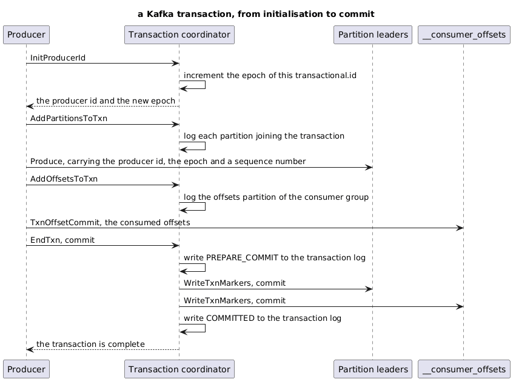
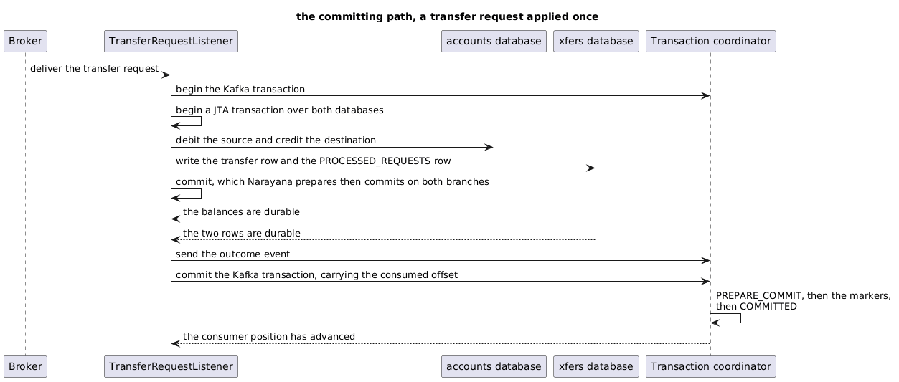
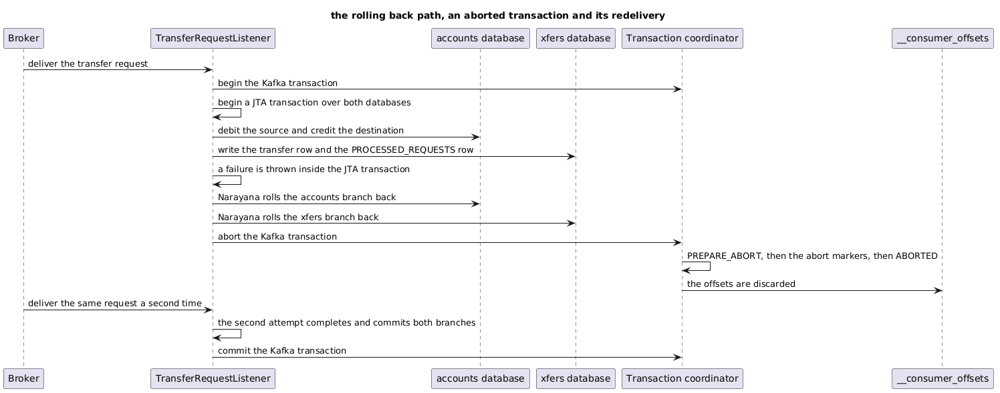
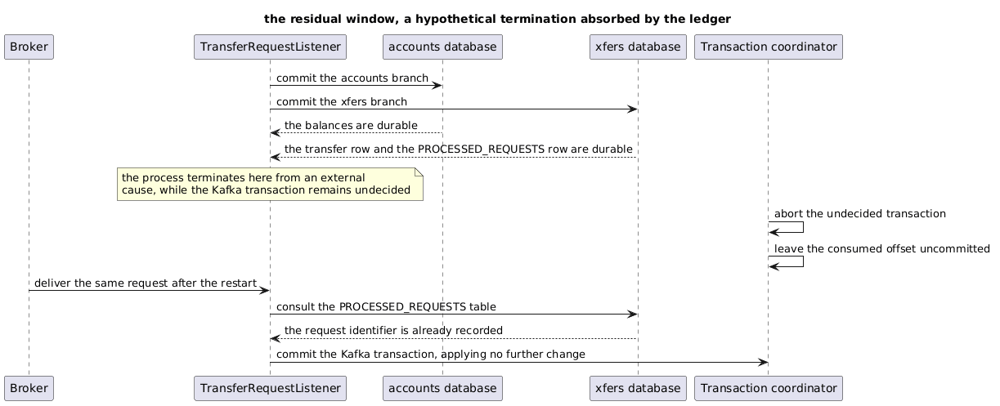

## Abstract

Apache Kafka supports transactions, and many developers who use Kafka daily would be unable to state precisely what those transactions cover. The term is familiar from relational databases, where a transaction groups several writes into a single atomic outcome. In enterprise grade applications, the same outcome might be extended from databases to message brokers. For example, one of the most common business case is having transactional operations spanning databases like PostgreSQL, Oracle, etc. and message brokers like ActiveMQ, Artemis, etc.

But Kafka isn't a message broker like the others and, as opposed to classical ones, it doesn't provide any XA adapter that would allow it to participate in 2PC transactions. However, implementing transactional operations enlisting database updates and Kafka messaging as a single work unit is possible and this article demonstrates how.

It establishes what a Kafka transaction actually contains, explains the protocol by which it reaches its outcome, and then measures how much atomicity becomes available when a Kafka transaction is chained around a database transaction in the same handler. The working implementation is the `transfer-kafka` module of the [`quarkus-distributed-tx`](https://github.com/nicolasduminil/quarkus-distributed-tx) repository, where it joins an XA and a saga implementation of the same money transfer use case, all three exposing the same REST contract and exercised by the same shared test suite.

The article is illustrated by a use mplementating of a money transfer application. between two accounts, which debits the source account, credits the destination account and records the movement as a transfer. It exposes a REST contract and satisfies an abstract test class.

---

## 1. The Question This Article Answers

The scenario is ordinary. A service consumes a message describing a money transfer, debits one account, credits another, records the transfer, and publishes an event announcing the result. Three kinds of state change occur: rows are written in PostgreSQL, a record is produced to a Kafka output topic, and the consumer position on the input topic advances so that the message is considered handled.

The question is what happens to those databases and topics when something interrupts the sequence. A developer accustomed to the X/Open Distributed Transaction Processing model will expect a transaction manager to enlist both the database and the broker as resources under one coordinator. However, as already mentioned, Apache Kafka isn't a message broker, like ActiveMQ, Artemis, etc., but a distributed log, and this changes everything. Nevertheless, Apache Kafka is designed to participate in a transaction protocol of its own design, with its own coordinator, its own log and its own commit decision, and that protocol is defined over the cluster.

Understanding the shape of the available guarantee therefore requires understanding the Kafka protocol first. Section 2 supplies that, in more detail.

## 2. The Anatomy of a Kafka Transaction

Kafka transactions were specified in [KIP-98, "Exactly Once Delivery and Transactional Messaging"](https://cwiki.apache.org/confluence/display/KAFKA/KIP-98+-+Exactly+Once+Delivery+and+Transactional+Messaging), and shipped in Kafka 0.11 in 2017. The specification combines two mechanisms that are frequently confused with each other, so it is worth separating them before describing either.

### 2.1 The idempotent producer

The first mechanism addresses duplication caused by producer retries. A producer that sends a record and then loses network connectivity before the acknowledgement arrives has no way to distinguish a lost record from a lost acknowledgement, so it retries, and the broker may append the record twice.

The idempotent producer solves this by giving each producer a numeric identifier, obtained from the broker, and by numbering every record it sends within a partition with a monotonically increasing sequence number. The broker remembers, for each producer identifier and partition, the sequence number it last accepted. A record arriving with a sequence number already seen by the broker is acknowledged and discarded. A record arriving with a gap in the sequence numbers is rejected as well. The effect is that a retry within a producer session appends exactly one record.

This mechanism operates per partition and per producer session. It is enabled by `enable.idempotence` proprty, and it is a prerequisite for the second mechanism.

### 2.2 The transactional producer and the transaction coordinator

The second mechanism groups several writes, possibly spanning several topics and partitions, into one atomic unit. A producer becomes transactional by being configured with a `transactional.id`, that survives restarts of the process.

That identifier is the key to a broker side component called the transaction coordinator. The `transactional.id` is hashed to a partition of an internal topic named `__transaction_state`, which KIP-98 calls the transaction log, and the leader of that partition acts as the coordinator for that producer. The coordinator holds the authoritative state of every transaction that producer opens, and it writes each state change durably into the transaction log before acting on it.

Two consequences follow immediately. The first is that the coordinator is a Kafka broker rather than a component of the application, so the decision to commit survives the possible death of the application process. The second is that a stable `transactional.id` allows a restarted producer to be recognized as the same logical producer, which is what makes recovery possible.

Recognition is enforced by a producer Linux epoch that the transaction coordinator stores in the transaction log beside the producer identifier for a given `transactional.id`.

Each transaction initiation, materialized by a call to `initTransactions()`, increments the stored epoch and returns the new value to the producer that caused the increment. Every request that producer issues afterward carries the producer identifier together with that epoch, whether the request produces records, adds partitions to the transaction, commits offsets or ends the transaction. A broker receiving a request whose epoch is lower than the value it holds refuses that request with an `InvalidProducerEpoch` error.

The purpose is to resolve the case in which two processes believe themselves to be the same producer. A service may be paused by a long garbage collection, or separated from the cluster by a network partition, while the platform running it concludes that it has failed and starts a replacement configured with the same `transactional.id`. Both processes are then live, and the older one remains unaware that it has been replaced. KIP-98 describes the remedy plainly, stating that the epoch is bumped "so that any previous zombie instance of the producer is fenced off". Because the replacement initialized later, it holds the higher epoch, and the broker refuses everything the older process sends. Authority is therefore determined by the broker, which observes both processes.

Developers familiar with optimistic locking will recognize the shape of the mechanism. The epoch plays the part that a version column plays in a JPA entity, where an update arriving with a stale version is refused rather than applied. The same initialization also resolves whatever transaction the previous incarnation left open, aborting it when it had yet to be decided.

### 2.3 The lifecycle, step by step

The protocol that reaches the outcome is itself a two phase commit, executed inside Kafka between the coordinator and the partition leaders. The sequence below follows the data flow specified in KIP-98.



Reading that sequence as a two phase commit makes its structure clear. The `EndTxn` request is the application asking for an outcome. The write of `PREPARE_COMMIT` to the transaction log is the point at which the decision becomes durable and irrevocable, exactly as a transaction manager writing its decision to an object store makes an XA outcome irrevocable. The markers written afterward are the second phase, instructing each participant to make the decision visible. The final write of `COMMITTED` records that the second phase completed.

An abort follows the same shape with `PREPARE_ABORT` and abort markers in place of their commit counterparts.

### 2.4 Control markers and the read_committed isolation level

The records a transaction produces are appended to their partitions as the transaction proceeds, before any outcome is known. Visibility, rather than placement, is what the outcome governs.

The mechanism is a control message, which KIP-98 defines as a special message "written to user topics, processed by clients, but never exposed to users". At commit or abort time the coordinator instructs each participating partition leader to append such a marker, carrying the producer identifier and a type of commit or abort. Markers may be written only through the internal `WriteTxnMarkers` request, since the specification states that "the writing of control messages is not permitted through the Produce API".

A consumer configured with `isolation.level=read_committed` uses those markers to decide what to deliver to the application. It reads only as far as the Last Stable Offset, which is the position beyond which a transaction remains undecided, and it discards records belonging to transactions whose marker says abort. The fetch response carries a list of aborted transactions so the consumer can discard that data directly.

The practical consequence is that a record produced inside a transaction that later aborts is physically present in the log and is withheld from every `read_committed` consumer. The default isolation level is `read_uncommitted`, under which such records are delivered, so the guarantee requires the setting to be made deliberately on the consuming side.

### 2.5 Consumer offsets as a transactional resource

A Kafka transaction can include the commit of consumer offsets. The internal topic `__consumer_offsets` is an ordinary Kafka topic, and a transactional producer may write to it as a participant in its transaction, through `sendOffsetsToTransaction(...)`. KIP-98 states the effect directly: "The consumed offsets are not visible externally until the transaction is committed." When the transaction commits, a marker is written to the offsets partition as well, the group coordinator materializes the offsets, and the consumer position advances. When the transaction aborts, the offsets are discarded and the consumer position remains where it was.

A consumer whose position has not advanced receives the same records again on its next fetch. Aborting a transaction therefore returns the input to the state it occupied before the handler ran. This is the property which makes a Kafka transaction to support operations that genuinely resemble rollbacks.

### 2.6 The scope of the guarantee

A Kafka transaction covers exactly three categories of state, all of them inside the Kafka cluster:

- records appended to data partitions
- consumer offsets written to `__consumer_offsets`
- the transaction state itself

Within that boundary the guarantee is strong, durable and coordinated by a broker that survives the application process.

## 3. The Boundary of the Kafka Protocol

The X/Open model achieves atomicity across heterogeneous resources by defining a common interface, XA, that every participating resource manager implements, and by placing a transaction manager above them to drive the protocol. A JDBC datasource configured with `jdbc.transactions=xa` supplies connections whose `XAResource` the transaction manager enlists, and the manager then calls `prepare` and `commit` on that resource alongside every other branch.

Kafka reaches its outcome through the protocol described in section 2, in which the coordinator is a broker, the participants are partition leaders, and the decision is recorded in a Kafka topic. The client API that exposes this protocol is the producer API, with `beginTransaction(...)`, `commitTransaction(...)` and `abortTransaction(...)`. An external transaction manager has no interface through which to make Kafka a branch of its own transaction, and the Kafka coordinator has no interface through which to make a database a participant in its own.

This arrangement is a design decision rather than an omission. KIP-98 aimed at a protocol that performs well at Kafka's throughput and remains available under broker failure, and a generic cross resource protocol would have imposed costs that the stream processing use cases driving the design did not require.

The practical conclusion for an application performing transactional database and Kafka operations is therefore specific. Two coordinators exist. The first is the JTA transaction manager, which is Narayana in the case of Quarkus, running inside the application process and authoritative over the XA resources enlisted in its transaction. In our project these XA resources are the two PostgreSQL databases. The second is the Kafka transaction coordinator, which is the broker leading the `__transaction_state` partition selected for the configured `transactional.id`, authoritative over the produced records, the consumer offsets and the transaction state itself, which are the categories section 2.6 enumerates. Each decides the outcome of its own resources alone, and the application decides how to arrange work between them. That arrangement is the subject of the remainder of this article.

## 4. Choosing the Direction: Consume, Write, Produce

Two arrangements are available, and the choice between them determines how much of the guarantee survives.

In the outbound arrangement the application writes to the database, publishes an event, and the Kafka transaction covers only the produced record. The two resources reach their outcomes through two separate commits, taken one after the other, and the interval between them is a window in which exactly one of the two commits has taken effect. An interruption inside that window leaves the resource that committed first in a status that isn't propagated to the other. Where the database commits first, the window ends with a committed row and its associated event unpublished, so every downstream consumer stays unaware of a money transfer that the database considers complete. Where the Kafka transaction commits first, the interruption finds the database transaction still open, and a transaction that remains open when its client connection ends is discarded by the server. The window therefore ends with a published event that consumers may already have acted upon, concerning a money transfer that the database retains no record of. The second case is the more troublesome of the two, because a published event is a fact that other systems have observed and erroneously acted upon, whereas an unpublished event is a fact that a later reconciliation can still supply.

In the inbound arrangement the application consumes a message, writes to the database, and publishes an outcome event, committing the consumed offset inside the same Kafka transaction. Here the Kafka transaction covers a resource that can be returned to an earlier value, namely the consumer position. An abort returns the consumer to its previous position, the broker redelivers the message, and the handler runs again.

The inbound arrangement is therefore the strongest of the two, for a reason that can be stated precisely. Its worst case is the repetition of work, which an idempotent handler absorbs, whereas the outbound worst case is the publication of an event that cannot be retracted. The implementation that follows uses the inbound arrangement.

## 5. The Implementation

### 5.1 The project the module joins

The module described here belongs to a repository that implements one use case three times. The use case is a money transfer between two accounts, which debits the source account, credits the destination account and records the movement as a transfer. The three implementations expose the same REST contract, satisfy the same abstract test class, and differ in the manner by which they make the operation atomic.

The data of that use case is divided between two PostgreSQL databases. The database named `accounts` holds one row per account, carrying the balance that a debit and a credit modify. The database named `xfers` holds one row per transfer, carrying the amount, the currency, the two account identifiers and a status. The division is deliberate, because it makes a single transfer a distributed transaction before any messaging is considered. One business operation writes to two independent database servers, each with a transaction manager of its own, and the operation is correct only when both writes take effect together or both are discarded together.

The first implementation, which the first [article](https://www.simplex-software.fr/posts-archive/quarkus-2pc-lra/) of this series describes, resolves that with the X/Open model. Both datasources are declared with `jdbc.transactions=xa`, which causes each connection to expose an `XAResource`, and Narayana enlists the two as branches of one global transaction and drives prepare and commit across them. The second implementation replaces the global transaction with a saga, in which each step owns a compensating action and a coordinator invokes those compensations when a later step fails. The third implementation is the subject of this article. It retains the XA arrangement for the two databases and places a Kafka transaction around it.

Two consequences of that inheritance govern the sections that follow. The first is that the database work of the handler is one transaction spanning two databases, so a rollback returns both of them to their previous state together, and a commit makes both sets of changes visible at the same instant. The second is that this two database transaction is itself nested inside a Kafka transaction, so the complete arrangement is a two phase commit over two relational databases chained within a scope that also covers a topic and the consumer offsets.

### 5.2 Module layout

The `transfer-kafka` module reuses the domain, the persistence layer, the transfer service and the REST contract of the XA implementation through a shared `transfer-core` module, so that the only difference between the two is the transaction strategy. It holds two XA datasources, `accounts` and `xfers`, exactly as the XA module does, which means Narayana already provides one atomic unit across both databases. The Kafka transaction is chained around that unit.

What the module adds is the Kafka material: a listener, a payload type, an idempotency ledger and an observer that records what a `read_committed` consumer actually receives. The idempotency ledger is the `PROCESSED_REQUESTS` table, which holds one row for each request identifier the handler has applied, and whose purpose is to make a second delivery of an already applied request harmless. It is a record of requests rather than a record of money transfers, which distinguishes it from the `XFERS` table holding the transfers themselves. Both tables reside in the datasource named `xfers`, while the balances reside in the datasource named `accounts`. Section 9 explains why the ledger is required.

### 5.3 The listener

The handler code is reproduced in the listing below.

```java
@ApplicationScoped
public class TransferRequestListener
{
  @Inject
  TransferService transferService;

  @Inject
  TransferRepository transferRepository;

  @Inject
  ProcessedRequestRepository processedRequestRepository;

  @Inject
  FailureInjection failureInjection;

  @Channel("transfer-events")
  KafkaTransactions<TransferEvent> emitter;

  private final Map<String, AtomicInteger> deliveries =
    new ConcurrentHashMap<>();

  public Map<String, Integer> deliveries()
  {
    Map<String, Integer> snapshot = new HashMap<>();
    deliveries.forEach((requestId, count) ->
      snapshot.put(requestId, count.get()));
    return snapshot;
  }

  public int deliveriesOf(String requestId)
  {
    AtomicInteger count = deliveries.get(requestId);
    return count == null ? 0 : count.get();
  }

  @Incoming("transfer-requests")
  @Blocking
  public Uni<Void> onTransferRequest(Message<TransferRequest> message)
  {
    String requestId = requestIdOf(message);
    deliveries.computeIfAbsent(requestId, key -> new AtomicInteger())
      .incrementAndGet();
    return emitter.withTransactionAndAck(message, tx ->
    {
      try
      {
        apply(requestId, message.getPayload()).ifPresent(tx::send);
        return Uni.createFrom().voidItem();
      }
      catch (RuntimeException runtimeException)
      {
        return Uni.createFrom().failure(runtimeException);
      }
    });
  }

  private Optional<TransferEvent> apply(String requestId,
    TransferRequest request)
  {
    if (QuarkusTransaction.requiringNew()
      .call(() -> processedRequestRepository.alreadyProcessed(requestId)))
      return Optional.empty();
    try
    {
      return Optional.of(complete(requestId, request));
    }
    catch (ApplicationException rejection)
    {
      return Optional.of(reject(requestId, request,
        rejection.getMessage()));
    }
  }

  private TransferEvent complete(String requestId,
    TransferRequest request)
  {
    return QuarkusTransaction.requiringNew().call(() ->
    {
      TransferDto transfer = transferService.processTransfer(request);
      processedRequestRepository.record(new ProcessedRequest(
        requestId, transfer.getTransferId(), LocalDateTime.now()));
      if (failureInjection.consume(requestId))
        throw new IllegalStateException("### injected failure between "
          + "the database write and the Kafka commit");
      return TransferEvent.of(requestId, transfer);
    });
  }

  private TransferEvent reject(String requestId,
    TransferRequest request, String reason)
  {
    return QuarkusTransaction.requiringNew().call(() ->
    {
      Transfer rejected = new Transfer(Common.getRandomId(),
        request.getSourceAccountId(), request.getDestinationAccountId(),
        request.getAmount(), request.getCurrency(),
        TransferStatus.REJECTED, LocalDateTime.now());
      transferRepository.createTransfer(rejected);
      processedRequestRepository.record(new ProcessedRequest(
        requestId, rejected.getTransferId(), LocalDateTime.now()));
      return TransferEvent.of(requestId, rejected.toDto(), reason);
    });
  }

  private String requestIdOf(Message<TransferRequest> message)
  {
    return message.getMetadata(IncomingKafkaRecordMetadata.class)
      .map(metadata -> String.valueOf(metadata.getKey()))
      .orElseGet(Common::getRandomId);
  }
}
```

The five injected members cover database access, failure injection and the Kafka side of the handler. `TransferService` and `TransferRepository` are inherited from the shared `transfer-core` module, and `ProcessedRequestRepository` is declared in this module to reach the `PROCESSED_REQUESTS` table that section 9 describes, these three members being the ones through which the handler reaches the two databases. `FailureInjection` is a small application scoped bean that defines a counter through which a test requests a deterministic interruption, and section 7 explains the position at which that interruption takes effect. The `emitter` field is the Kafka side of the handler, declared as `KafkaTransactions<TransferEvent>` and bound by `@Channel` to the outgoing channel named `transfer-events`. That declaration is what causes Quarkus to configure a transactional producer for the channel, as section 6 shows.

The `deliveries` map counts the arrivals of each request identifier, and the two accessor methods publish that count so that a test may assert upon it. The count is the observable on which the demonstration of rollback rests, because an aborted transaction is established by a second delivery of the same message and the count reflects that. A `ConcurrentHashMap` holds the counters because the Kafka worker threads access the map concurrently.

The method `onTransferRequest` is the entry point. The annotation `@Incoming` binds it to the incoming channel named `transfer-requests`, and `@Blocking` moves its execution from the I/O thread to a worker one. This is because JDBC calls block the calling thread. The method obtains the request identifier, records the delivery, and hands the remaining work to `withTransactionAndAck(...)`.

That single call performs four operations. It begins a Kafka transaction, it supplies a `TransactionalEmitter` to the given function, it enlists the offset of the consumed record in the transaction, and it determines the outcome from the `Uni` the function returns. A `Uni` that completes causes the transaction to commit and the message to be acknowledged. A `Uni` that carries a failure causes the transaction to abort and the message to be negatively acknowledged.

The body of the function is wrapped in a `try` block whose `catch` clause converts a `RuntimeException` into a failed `Uni`. The conversion matters because the function executes inside a Mutiny pipeline, in which an exception thrown synchronously and a failure carried by the returned `Uni` reach different handlers. Returning the failure keeps the outcome on the path that `withTransactionAndAck(...)` observes. This is the path that aborts the transaction and leaves the offset uncommitted.

The call `apply(requestId, message.getPayload()).ifPresent(tx::send)` performs the work and publishes its outcome. The method `apply` returns an `Optional`, and `ifPresent(...)` sends an event exactly when one is present, through the `TransactionalEmitter` and therefore inside the open transaction. The empty case belongs to a request already recorded in `PROCESSED_REQUESTS`, which produces no event.

The method `apply` arranges the three possible outcomes of a request. It first consults the `PROCESSED_REQUESTS` table in a transaction of its own and returns an empty `Optional` when the request identifier is already present, which is the idempotent path of section 9. Otherwise, it delegates to `complete(...)`. An `ApplicationException`, which is the type the shared transfer service throws when the business refuses an operation, is caught and routed to `reject(...)`, whereas every other runtime exception leaves the method and reaches the `catch(...)` clause of the caller. That one distinction is the policy stated in section 8.

The method `complete(...)` performs the successful path inside one JTA transaction, begun by `QuarkusTransaction.requiringNew()`, which Narayana commits when the lambda function returns a value and rolls back when it throws. Three operations share that transaction, and they reach both databases. The call `transferService.processTransfer(...)` updates the two account rows in `accounts` and writes the transfer row in `xfers`. The row written to `PROCESSED_REQUESTS` records the request identifier together with the resulting transfer identifier, in `xfers` beside the transfer. Narayana therefore enlists two XA branches for this single transaction and drives prepare and commit across both, which is the two phase commit occurring inside a Kafka transaction. The call `failureInjection.consume(requestId)` occupies the final position, which places any injected exception before the commit and therefore within the scope that the rollback discards.

The method `reject(...)` writes a refused outcome, likewise in a fresh transaction. It creates a transfer row carrying the status `REJECTED` directly through the repository, and it records the request identifier in `PROCESSED_REQUESTS` so that a redelivery of a refused request produces a single rejection event. The reason supplied by the exception is copied into the event, which allows a consumer to learn the ground on which a transfer was refused as well as the fact of the refusal.

The method `requestIdOf(...)` reads the identifier from the Kafka record key through `IncomingKafkaRecordMetadata`, and generates one when a record arrives without a key. The key is therefore the name under which a logical request is known across its deliveries, a property to which section 9 returns.

### 5.4 The configuration

The incoming channel carries two settings whose purpose is frequently misread.

```properties
mp.messaging.incoming.transfer-requests.commit-strategy=ignore
mp.messaging.incoming.transfer-requests.failure-strategy=ignore
```

The first instructs SmallRye Reactive Messaging to leave offset commits entirely to the transaction. Any other commit strategy would advance the consumer position independently of the transaction outcome.

The second instructs the channel to let the transaction decide what happens after a failure. A message whose processing succeeds is acknowledged, and a message whose processing fails is negatively acknowledged. This operation is named "nacking". Under the ignore failure strategy a negatively acknowledged message causes the consumer to reset to the last committed offsets and to resume from there, which is the redelivery described in section 7. The log line the application emits at that moment reads as follows.

```
SRMSG18204: A message sent to channel `transfer-requests` has been nacked,
            ignored failure is: ### injected failure between the database
            write and the Kafka commit
```

The producer side requires no explicit client configuration, because Quarkus recognises a `KafkaTransactions` channel and supplies the necessary settings itself.

```
Transactional producer detected for channel 'transfer-events', setting
following default config values:
  mp.messaging.outgoing.transfer-events.transactional.id=
      ${quarkus.application.name}-${channelName}
  mp.messaging.outgoing.transfer-events.enable.idempotence=true
  mp.messaging.outgoing.transfer-events.acks=all
```

Those three settings are precisely defining a stable transactional identifier, the idempotent producer underneath it, and the full acknowledgement so that a committed record is durable on every in sync replica.

One further setting requires explanation. Quarkus Dev Services starts the broker in a container, and it offers a choice among several providers. Apache Kafka is available in two forms, a conventional build running on the Java virtual machine and a build compiled ahead of time with GraalVM, which starts faster and is the default in Quarkus 3.37. Redpanda is an independent implementation of the Kafka protocol, written in C++ and distributed as a single binary, which presents the same client API over a different internal architecture. Strimzi is the project that operates Apache Kafka on Kubernetes, and the container images it publishes for testing hold a genuine Apache Kafka broker running on the Java virtual machine.

The choice among the above mentioned providers matters for one reason. The Quarkus documentation states that [Redpanda transactions do not support exactly once processing](https://quarkus.io/guides/kafka-dev-services/), and it records the absence of KIP-447 and KIP-360. KIP-447, titled "Producer scalability for exactly once semantics", is the proposal through which a transactional producer commits consumer offsets while carrying the metadata of its consumer group, which allows the broker to fence a member that has left the group. That commit is the mechanism section 2.5 described and the one on which this implementation relies. KIP-360, titled "Improve reliability of idempotent/transactional producer", governs the recovery of a producer whose identifier the broker has discarded.

The module therefore names its provider explicitly, rather than inheriting a default value that has changed across Quarkus versions.

```properties
quarkus.kafka.devservices.provider=upstream-kafka-native
```

The test run confirms the choice, reporting the image `apache/kafka-native:4.2.0`.

### 5.5 The nesting order

The Kafka transaction is the outer one, and the inner one is the JTA transaction that spans the two databases. That ordering is deliberate, and reversing it would change the guarantee.

Placing Kafka outside means the consumed offset belongs to the transaction that is decided last, so the input remains replayable until everything else has succeeded. The inner transaction commits first, which through the X/Open protocol makes the changes in `accounts` and in `xfers` visible at one instant, and it does so within the lifetime of the Kafka transaction. The Kafka transaction then commits the produced event together with the offset.

The complete arrangement therefore nests three levels. The two relational databases form the branches that Narayana enlists and that constitute one JTA transaction. That unit of work is entirely contained in one Kafka transaction covering the produced event and the consumed offset. Atomicity within each level is guaranteed by the protocol.

## 6. The Committing Path

The ordinary case proceeds as follows.



Four observable facts follow. The balances have moved. The transfer row is present, and so is the `PROCESSED_REQUESTS` row naming the request. A consumer reading with `isolation.level=read_committed` has received the outcome event. The consumer position has advanced, so the message is delivered once.

## 7. The Rolling Back Path

An interruption occurring while the Kafka transaction is still open produces the sequence below. In the demonstration the interruption is injected deterministically, so that the behavior is asserted in a test rather than observed by chance.



The failure is injected on one delivery only. A test calls `armOnce` with the request identifier, which sets a counter held against that identifier to one. The method `complete` then calls `failureInjection.consume(requestId)`, which decrements the counter and returns true while its value remains positive. The failure therefore occurs on the first delivery of the record, and every subsequent delivery of the same record proceeds normally. The demonstration consists of two deliveries, and the two are described in turn.

The position of the injected failure is what makes the first delivery a rollback of both resources. The exception is thrown inside the JTA transaction, after the balances have been updated in the `accounts` database and the transfer row together with the `PROCESSED_REQUESTS` row have been written to the `xfers` database, and before Narayana commits. All three writes therefore belong to a transaction that rolls back, and because both datasources are XA resources of that single transaction, the two databases roll back together. The same exception then leaves the function given to `withTransactionAndAck(...)` as a failed `Uni`, which aborts the Kafka transaction, and the abort discards the produced event and the consumed offset together. The consumer position consequently remains where it was, and the broker delivers the same record a second time.

On the second delivery the counter stands at zero, so `failureInjection.consume(requestId)` returns false and no exception is thrown, and `PROCESSED_REQUESTS` holds no row for the request, because the first attempt committed nothing. The delivery therefore updates the two PosrgreSQL databases, records the request identifier, publishes the event and commits, exactly as section 6 described.

Four facts are observable once the sequence has settled. The balances differ from their initial values by one amount rather than by two. One transfer row exists. One outcome event carrying the status `COMPLETED` is visible to a consumer reading with `isolation.level=read_committed`. The listener counted two deliveries of the request identifier.

The third and fourth facts taken together are what establish the rollback. Consider the alternative in which the database work of the first delivery had been retained rather than discarded. `PROCESSED_REQUESTS` would then hold a row for the request identifier, the second delivery would be recognized as a replay, the method `apply` would return an empty `Optional`, and no event would reach the topic. A `COMPLETED` event visible after exactly two deliveries is therefore incompatible with the database having kept anything from the first attempt. The single movement of money excludes a double application, and the presence of the event excludes a first attempt that committed.

This form of evidence requires no observation of any intermediate state, which is its practical value. Establishing the rollback directly would mean reading the database during the interval between the writes and the abort.

The abort appears in the application log as follows.

```
SRMSG18262: Aborting transaction for producer id
            kafka-producer-transfer-events in channel transfer-events
```

## 8. A Business Rejection Is an Outcome

A transfer may be refused for reasons that belong to the business rather than to the infrastructure. The source account holds insufficient funds, an account identifier names no account, or the amount is invalid. Treating such a case as a transaction failure would be a mistake, and the reason is instructive.

An aborted transaction returns the message to the broker, and the broker delivers it again. A request refused for insufficient funds will be refused again on the second delivery, and on every delivery thereafter, which produces an unbounded loop.

The implementation therefore distinguishes the two categories. A business rejection is recorded as a committed outcome: a transfer row is written with the status `REJECTED`, the balances remain as they were, a rejection event carrying the reason is published, and the Kafka transaction commits so the offset advances. Transaction abort is reserved for infrastructure failure.

The distinction is visible in the code shown in section 5.3, where `ApplicationException` is caught and routed to `reject`, while any other runtime exception propagates and aborts.

One detail of that routing requires explicit statement, because it is a common source of defects. The rejection is written in a fresh transaction rather than in the one that failed. A JTA transaction in which a runtime exception has been raised is already marked rollback only, and further writes in it would be discarded at commit time.

## 9. The Residual Window and the Idempotency Ledger

The database commits before the Kafka transaction does, so an interval separates the two commits.

The case examined in this section is hypothetical. Its premise is that the process terminates during that interval which separates the two commits, for a reason outside the application, such as the container being stopped, the node failing or the operating system ending the process. No instruction in the handler produces that termination, and the implementation has no means of preventing it.

Suppose therefore that the process ends after Narayana has committed the database transaction and before the Kafka transaction has been decided. The database change survives, because a committed transaction is durable. The Kafka transaction is undecided, because the application that would have committed it no longer exists. The coordinator will eventually abort it, which leaves the consumed offset uncommitted.



The abort arrives by one of two routes. The coordinator aborts a transaction that stays open beyond its timeout, and the restarted process increments the epoch of its `transactional.id` during initialization, which fences the previous instance and resolves the transaction it abandoned. Either route leaves the offset uncommitted.

The consequence is the redelivery, after the process restarts, of a message whose effect is already persistent. The implementation renders that redelivery harmless with the idempotency ledger introduced in section 5.2. The `PROCESSED_REQUESTS` table carries one row per request identifier, written in the same database transaction as the transfer itself, and the handler consults it before performing any work. A redelivered request whose row is already present produces no second movement of money and no second event, and the transaction commits so the offset advances.

The request identifier is carried by the Kafka record key, which gives each logical request a stable name across deliveries.

This case is not reproduced in the test suite, since killing a process at a chosen instant would make the assertions depend on timing. What the test suite does verify is the mechanism that absorbs the consequence, by publishing the same request identifier twice and asserting that the money moves only once and that one event is observed. That is the fourth row of the table in section 10, and it exercises the same path a redelivery after a restart would take.

Taking sections 6 through 9 together, the resulting guarantee is effectively once processing: every outcome is applied exactly one time, achieved through atomic commitment where the protocols allow it and through idempotency where the interval between two commitment points remains.

## 10. What the Test Suite Establishes

Each test in the current test suite examines the database state, what a `read_committed` consumer received, and the number of deliveries.

| Case | Deliveries | Balances | Event observed |
|---|---|---|---|
| A valid request | 1 | moved once | one, status `COMPLETED` |
| A failure between the two commits | 2 | moved once | one, status `COMPLETED` |
| Insufficient funds | 1 | unchanged | one, status `REJECTED`, carrying the reason |
| A request already applied | 2 | moved once | one |

The second and fourth rows in the table above demonstrate that two deliveries produce a single effect.

The module also satisfies the shared contract that the XA and saga implementations satisfy, through the same abstract test class, which establishes that the three implementations differ in transaction strategy alone.

```
Tests run: 5, Failures: 0, Errors: 0 -- in MoneyTransferKafkaIT
Tests run: 4, Failures: 0, Errors: 0 -- in TransferKafkaTransactionIT
```

Across the whole repository the reactor runs 27 integration tests, and the end to end script that drives the assembled stack over HTTP reports 101 passing assertions.

## 11. Running the Demonstration

Integration tests use Quarkus Dev Services, so a running Docker daemon suffices and no manual broker or database setup is required.

```bash
mvn clean verify
```

The assembled stack runs under Compose, with a single Kafka broker in KRaft mode alongside the databases, the XA and 2PC implementation and the saga and LRA implementation.

```bash
mvn clean package
docker compose up -d
./test-all.sh
```

One Compose setting requires explicit configuration, because its default value prevents a transactional producer from initialising on a single broker.

```yaml
KAFKA_TRANSACTION_STATE_LOG_REPLICATION_FACTOR: 1
KAFKA_TRANSACTION_STATE_LOG_MIN_ISR: 1
```

Both default to 3. The transaction log described in section 2.2 is an ordinary Kafka topic and obeys ordinary replication rules, so a single broker cluster must relax them.

The two paths may also be driven by hand.

```bash
BODY='{"sourceAccountId":"ACC90","destinationAccountId":"ACC91",
"amount":30.00,"currency":"EUR"}'

curl -s -XPOST -H 'Content-Type: application/json' -d "$BODY" \
  'http://localhost:8095/kafka/requests?requestId=demo-1'
curl -s http://localhost:8095/kafka/events
curl -s http://localhost:8095/kafka/deliveries

curl -s -XPOST http://localhost:8095/kafka/fail-once/demo-2
curl -s -XPOST -H 'Content-Type: application/json' -d "$BODY" \
  'http://localhost:8095/kafka/requests?requestId=demo-2'
curl -s http://localhost:8095/kafka/deliveries
```

The second sequence injects one failure, so the delivery count for `demo-2` becomes two while the balance moves once.

## 12. Comparison with the Two Earlier Implementations

The repository now contains three answers to the same requirement, which permits a comparison on evidence.

| | XA and 2PC | Saga and LRA | Chained Kafka and JTA |
|---|---|---|---|
| Coordinator | Narayana, embedded in the application process | A separate LRA coordinator that calls participants back | Two coordinators, Narayana for the database and a Kafka broker for the log |
| Resources covered atomically | Both databases | Each local step, with compensation above them | Produced records, consumer offsets and transaction state, with the database chained |
| Isolation | Total, since nothing is observable before commit | A reservation is observable while the saga is in flight | Records are withheld from `read_committed` consumers until commit |
| Recovery from an interrupted outcome | The Narayana recovery manager resolves in doubt branches | The coordinator retries the completion callbacks | The broker expires and aborts, and the message is redelivered |
| Residual exposure | Resources are locked between prepare and commit | Compensation is visible as an audit trail | One interval between two commits, absorbed by idempotency |
| Coupling | The two databases live under one process | Participants are autonomous | The application and the broker are independently recoverable |

The property distinguishing the chained Kafka and JTA arrangement from the XA and 2PC one is the nature of its recovery. XA restores the intended outcome by completing a prepared transaction. The chained arrangement restores it by replaying the input, which is available because the consumer offset was part of the transaction that aborted. Replay is a weaker instrument than prepared state, but it is sufficient whenever the work it replays is idempotent.

## 13. The Present and the Future

The arrangement described here is the strongest available today for an application that consumes a message and must change a database as a consequence. 

### 13.1 Kafka as a participant in an external two phase commit

[KIP-939, "Support Participation in 2PC"](https://issues.apache.org/jira/browse/KAFKA-15370) proposes to let a Kafka producer act as a participant in an externally coordinated two phase commit. It introduces a broker configuration named `transaction.two.phase.commit.enable` and client methods `prepareTransaction` and `completeTransaction`, which together supply the half of the protocol an external transaction manager requires. The work remains in progress, the Apache issue currently targets a future release, and the [Kafka monthly digest for December 2025](https://developers.redhat.com/blog/2026/01/08/kafka-monthly-digest-december-2025) reports that the public API changes were reverted for the time being. Should it be released, a further step would still be required, namely an adapter presenting a Kafka producer to Narayana as an XA resource.

### 13.2 The transactional outbox, and the belief that it is the only option

A widely held view holds that the transactional outbox, driven by change data capture, is the only correct way to change a database and publish to Kafka in one operation. The view deserves examination rather than contradiction, because the pattern it recommends is sound and because the reasoning behind the view contains one accurate observation and one conflation.

The pattern operates as follows. The application writes the business rows and a row describing the event to be published into the same database, inside one local transaction. Publication becomes a separate concern, carried out afterward by a relay that reads the outbox and writes to Kafka. In the Debezium form of that relay the reading is performed through logical decoding of the PostgreSQL write ahead log over the streaming replication protocol, which means the relay observes committed changes as the database records them rather than by polling the outbox table, and the [Outbox Event Router](https://debezium.io/documentation/reference/stable/transformations/outbox-event-router.html) transformation turns each captured row into a message whose topic derives from the aggregate type and whose key derives from the aggregate identifier. A simpler variant replaces change data capture with a process that queries the outbox table on a schedule, and that variant is the one the word polling describes accurately.

The upsides of this pattern are:

- atomicity becomes local, since one database transaction covers both the business change and the intent to publish, so no distributed protocol participates in the critical path;
- availability improves, since the event is durable once that transaction commits, and a broker that is unreachable delays publication while leaving the business operation unaffected.

But they aren't for free as the following costs accompany them:

- the deployment requires an additional component, namely Kafka Connect with a specialized connector;
- the database requires an output plugin for logical decoding and a replication slot;
- publication becomes asynchronous, so the event appears some time after the commit rather than within the operation that caused it;
- the outbox table requires pruning.

The downside of the pattern concerns direction, and it is the subject of section 4. An outbox addresses the outbound direction, in which a database change must produce an event. The arrangement described in this article addresses the inbound direction, in which a message must produce a database change. Applied to the inbound direction, an outbox covers one half of the problem, because the resource that must return to its previous value is the consumer offset, and no table in the database holds it. An application may close that half by recording the consumed offset in the database as well and by seeking to the recorded position whenever the consumer starts, which makes the database the single authority over both the effect and the progress. That arrangement is correct, and it is the natural companion of an outbox, at the cost of managing partition assignment and seeking explicitly, which is the work that `withTransactionAndAck` performs here through a single argument.

## 14. Conclusion

Until KIP-939 or an equivalent proposal changes the landscape, the conclusion is a practical one. A Kafka transaction covers produced records and consumer offsets under a broker side coordinator that records every decision in a replicated log. Chaining a database transaction inside it extends atomic behavior to every failure the application itself raises, makes the input replayable whenever the outcome is in doubt, and leaves a single interval that an idempotency ledger closes. For the overwhelming majority of services that consume a message and change a database, that is the guarantee they actually need.

## References and Further Reading

- [KIP-98, Exactly Once Delivery and Transactional Messaging](https://cwiki.apache.org/confluence/display/KAFKA/KIP-98+-+Exactly+Once+Delivery+and+Transactional+Messaging), the specification of Kafka transactions.
- [KAFKA-15370, Support Participation in 2PC](https://issues.apache.org/jira/browse/KAFKA-15370), tracking KIP-939.
- [Kafka Transactions and Exactly-Once Processing](https://smallrye.io/smallrye-reactive-messaging/latest/kafka/transactions/), the SmallRye Reactive Messaging reference for the `KafkaTransactions` emitter.
- [Apache Kafka Reference Guide](https://quarkus.io/guides/kafka), the Quarkus guide, whose sections on exactly once processing and on chaining Kafka transactions with Hibernate ORM transactions describe the forms used here.
- [Dev Services for Kafka](https://quarkus.io/guides/kafka-dev-services/), including the broker providers available for testing.
- [Using transactions in Quarkus](https://quarkus.io/guides/transaction), for the Narayana side of the arrangement.
- [Distributed Transactions in Enterprise Applications: From X/Open to MicroProfile LRA](https://www.simplex-software.fr/posts-archive/quarkus-2pc-lra/), the first article in this series, covering the XA and saga implementations compared in section 12.
- [Debezium Outbox Event Router](https://debezium.io/documentation/reference/stable/transformations/outbox-event-router.html), the transformation that turns captured outbox rows into messages.
- [Debezium connector for PostgreSQL](https://debezium.io/documentation/reference/stable/connectors/postgresql.html), describing the logical decoding of the write ahead log on which the relay of section 13.2 depends.
- [`quarkus-distributed-tx`](https://github.com/nicolasduminil/quarkus-distributed-tx), the repository containing all three implementations and the shared test suite.
